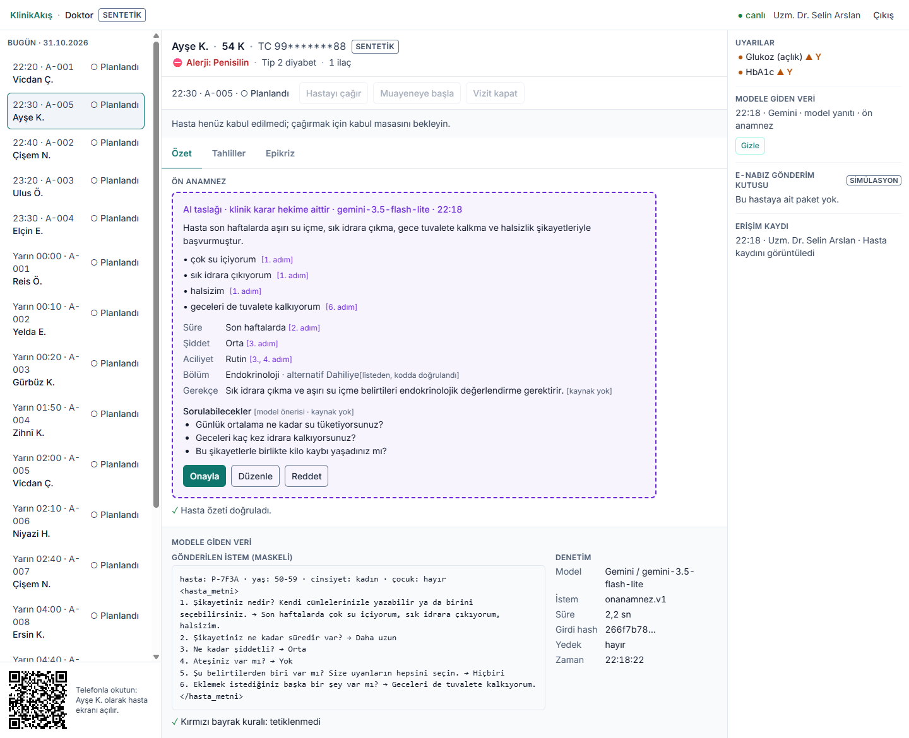
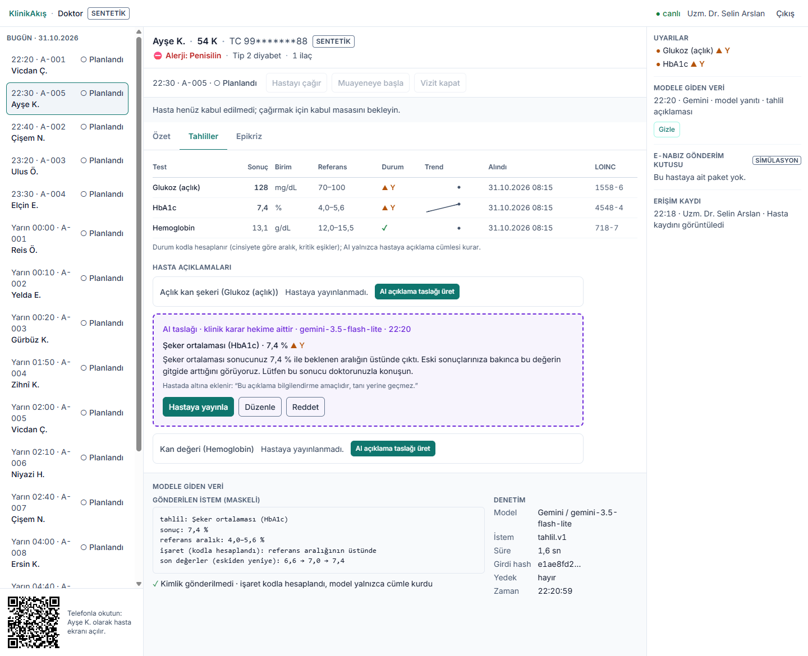
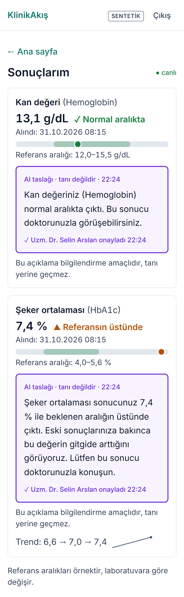

# KlinikAkış

[](https://github.com/YusufGUNEL/KlinikAkis/actions/workflows/ci.yml)

Hastane polikliniğinde hastanın yolculuğunu (randevu → kabul → muayene → tahlil → epikriz) baştan sona
gösteren, üstüne güvenli bir yapay zekâ katmanı eklenmiş demo uygulama. Hasta ekranı telefonda, doktor ekranı
dizüstünde açılır; iki ekran canlı olarak birbirini günceller. **Tüm veriler sentetiktir.**

**▶ Canlı demo: [klinikakis.onrender.com](https://klinikakis.onrender.com)** · rol seçip girin (Hasta · Doktor · Kabul · TV).
Ücretsiz sunucu uykudaysa ilk açılış yaklaşık 1 dakika sürer.


*Doktor ekranı: AI'ın hazırladığı ön anamnez taslağı (mor, kesik çizgili) hekim onaylayana kadar taslak kalır.
Altta modele giden maskeli veri ve denetim kaydı.*

<table>
  <tr>
    <td width="66%" valign="top">
      
      <br><em>Tahliller: ▲ Y işaretini kod verir, model yalnızca hastaya açıklama cümlesi kurar.</em>
    </td>
    <td width="34%" valign="top">
      
      <br><em>Hastanın telefonu: yalnızca hekimin yayınladığı açıklama görünür.</em>
    </td>
  </tr>
</table>

> ### Karar kodda, cümle modelde
> Klinik kararları kod verir: HbA1c 7,4 değerinin "yüksek" olduğunu, hangi bölümlerin önerilebileceğini ve
> göğüs ağrısında 112'ye yönlendirmeyi deterministik kurallar belirler. Dil modeli yalnızca cümle kurar ve
> şemaya bağlı JSON döner; listede olmayan bir cevap sunucuda reddedilir. Modelin yazdığı hiçbir serbest metin
> hekim onayı olmadan hastaya ya da kayda geçmez. Kırmızı bayrakta model hiç çağrılmaz.

**Teknoloji:** .NET 10 Minimal API · Angular 22 + PrimeNG · SignalR · EF Core (SQLite / PostgreSQL) ·
Microsoft.Extensions.AI + Gemini · Docker · Render

---

## Demo senaryosu (5-7 dakika)

1. Doktor ekranındaki QR okutulur, telefon sentetik hasta **Ayşe K.** (54, Tip 2 diyabet, penisilin alerjisi)
   olarak açılır. Şikayet sohbeti: "Çok su içiyorum, sık idrara çıkıyorum, halsizim."
2. Kırmızı bayrak taraması temiz → AI özet ve bölüm önerisi (Endokrinoloji, alternatif Dahiliye) → hasta randevu alır.
3. Randevu doktor listesine ve kabul ekranına **canlı** düşer; kabulde takip numarası üretilir.
4. Doktor mor ön anamnez kartını düzeltip onaylar; "Hastayı çağır" ile TV sıra ekranı ve hastanın telefonu güncellenir.
5. Tahliller: HbA1c trendi 6,6 → 7,0 → 7,4, kodla verilen ▲ Y işareti, AI açıklama taslağı → "Hastaya yayınla".
6. Epikriz taslağı ve ICD-10 önerisi (kapalı listeden) onaylanır → "Vizit kapat" → e-Nabız gönderim kutusu (simülasyon).
7. Kapanış: başka bir hasta "göğsüm ağrıyor, terliyorum" yazar → anında 112 bandı; "Modele giden veri" panelinde
   "Kırmızı bayrak kuralı: Göğüs ağrısı + terleme · model çağrılmadı" (denetim kaydında kural adı `GogusAgrisiTerleme`).

## Güven katmanı

| Önlem | Nasıl |
|---|---|
| Maskeleme | TC (sağlama haneli), telefon, e-posta, tam tarih ve Türkçe ekli ad/soyad ("Ayşe'nin") modele gitmeden `[TC]`, `[TARIH]`, `[AD]`… olur; hasta takma adla, yaş aralıkla gider |
| Kırmızı bayrak | Göğüs ağrısı, inme bulguları, intihar düşüncesi… LLM'den önce kodla taranır; tetiklenirse model çağrılmaz |
| Şema + sunucu doğrulaması | JSON şema ve enum; bölüm/kod listede yoksa, işaretle çelişen cümle varsa yanıt reddedilir |
| Yedek | Zaman aşımı, hata ya da geçersiz yanıtta kural tabanlı taslak; arayüzde yine mor "otomatik taslak" |
| Denetim kaydı | Her AI çağrısı: sağlayıcı, model, istem sürümü, maskeli girdi, girdi hash'i, çıktı, süre, yedek nedeni |
| Hekim onayı | AI çıktısı Onayla / Düzenle / Reddet olmadan klinik kayda ve hastaya görünen alana yazılmaz |
| Maliyet | Bağlantı adresi başına dakikada 10 AI isteği (Render proxy arkasında tüm istemciler için ortak), günlük çağrı kotası; Gemini ücretsiz katmanı, faturalandırma kapalı |

## Mimari

```
Telefon / Dizüstü / TV ──REST (JWT)──► Minimal API ──► Domain kuralları (durum makinesi, H/L, kırmızı bayrak)
          ▲                               │  └──► AiHatti ──► maskeleme → kural → kota → IChatClient → doğrulama → yedek
          └──── SignalR {tur, id} ◄───────┘  └──► EF Core ──► SQLite (yerel) / PostgreSQL (Neon)
```

Ayrıntılı şemalar (bileşenler, AI hattı, canlı senkron): [docs/architecture.md](docs/architecture.md) ·
Teknik şartname: [docs/SPEC.md](docs/SPEC.md)

## Yerelde çalıştırma

Gereken: .NET 10 SDK, Node 24.

```bash
# Backend (SQLite, ağsız çalışır; anahtar yoksa Fake AI sağlayıcısı kullanılır)
dotnet run --project src/KlinikAkis.Api

# İsteğe bağlı: gerçek model (Google AI Studio ücretsiz anahtarı)
dotnet user-secrets set "GEMINI_API_KEY" "<anahtar>" --project src/KlinikAkis.Api
# ve AI__Provider=Gemini ortam değişkeni

# Frontend (/api ve /hubs backend'e vekillenir)
cd src/web && npm ci && npm start     # http://localhost:4200
```

API dokümanı geliştirme ortamında Scalar ile `/scalar` altında. Demo verisini sıfırlamak için giriş ekranında
"Demo verisini sıfırla" (iki tıklama: "Emin misiniz? Sıfırla") ya da `POST /api/demo/reset`.

## Testler

```bash
dotnet test                 # xUnit: birim + WebApplicationFactory entegrasyon + SignalR
cd src/web && npm test      # Angular (Vitest)
```

Kapsananlar: kırmızı bayrakta LLM'in çağrılmaması, Türkçe çekimli/büyük harfli belirtiler, TC/telefon/e-posta ve
ekli ad maskeleme, cinsiyete göre tahlil işareti ve kritik eşikler, listede olmayan bölümün reddi, zaman aşımında
yedek, yayınlanmamış sonucun hastaya görünmemesi ve başka hastaya 403, randevu durum makinesi (geçersiz geçiş 409),
deterministik seed, SignalR grup yayını, hasta bandında alerji gösterimi.

## Sınırlar

- Gerçek kimlik doğrulama yok; demo JWT rol seçimiyle verilir.
- Hekim–hasta ilişkisi denetlenmez: doktor rolü kendi randevusu olmayan hastanın kaydını da açıp
  onaylayabilir. Gerçek kimlik doğrulamada bu ilişki sunucuda denetlenir.
- Maskeleme yalnızca kayıttaki ad/soyadı ve kalıplı kimlik verilerini yakalar; metindeki başka
  kişi adları ve adresler maskelenmez. Üretimde NER tabanlı ek katman gerekir. Ad aynı zamanda
  sözcükse ("Can", "Deniz") o sözcük de maskelenir (fazla maskeleme güvenli taraftır).
- Kırmızı bayrak sohbet başınadır: ön anamnezsiz doğrudan randevu ekranı (Aşama 3 yolu) açık kalır;
  bayraklı sohbetin kendisiyle randevu alınamaz.
- Kırmızı bayrak listesi kapsayıcı değildir ve bilinçli olarak fazla tetikler; olumsuzlamayı ayırt etmez.
- Referans aralıkları örnektir; laboratuvara göre değişir.
- e-Nabız ve takip numaraları simülasyondur; gerçek servise bağlanılmaz.
- Şema `EnsureCreated` ile kurulur (migration yok); üretimde migration'a geçilir.
- SignalR tek örnekte çalışır; yatay ölçekte Redis backplane gerekir.
- Ücretsiz Gemini katmanında Google girdileri ürün geliştirmede kullanabilir; demo verisi sentetik ve
  maskeli olduğu için kabul edildi. Gerçek hasta verisinde ücretli katman veya yerel model (Ollama) gerekir.
- Tıbbi cihaz değildir; AI çıktıları hekim onayı bekleyen taslaktır.
