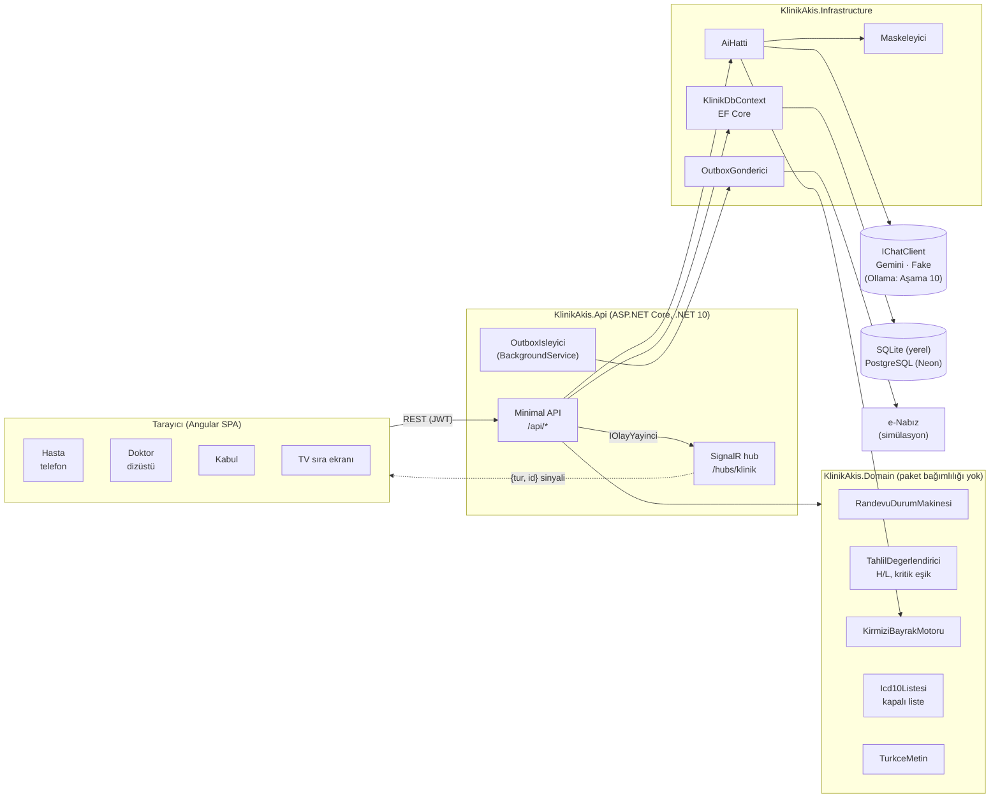
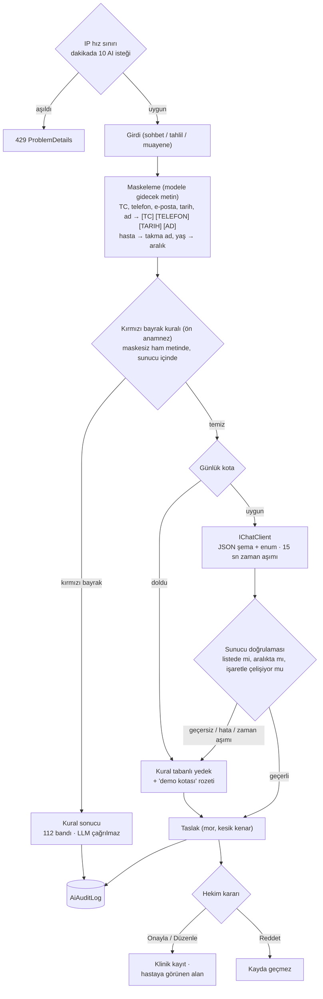
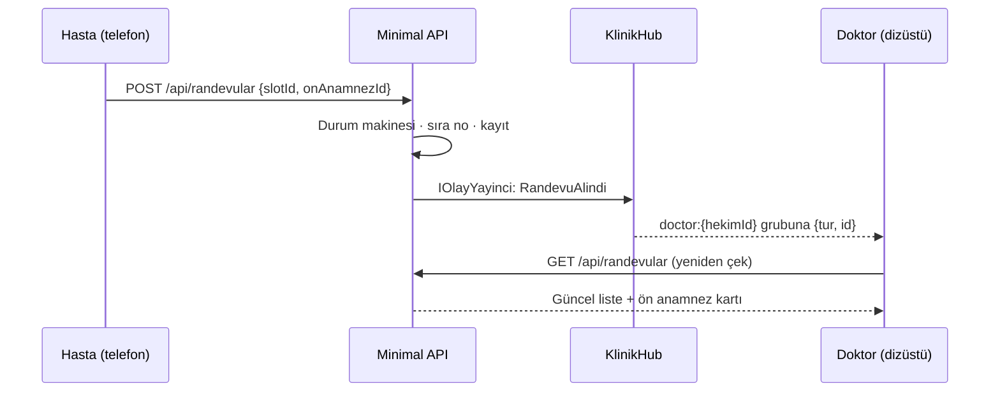

# Mimari

Tek Docker imajı: Angular uygulaması, Minimal API ve SignalR hub'ı aynı origin'den sunulur (CORS yok,
WebSocket vekil sorunu yok). Ayrıntılı gereksinimler: [SPEC.md](SPEC.md).

## Bileşenler

Bağımlılık yönü: `Api → Infrastructure → Domain`, `Api → Domain`. Sınıflandırma kararları (randevu durumu,
tahlil işareti, kırmızı bayrak, ICD-10 listesi) Domain'de, saf C# olarak test edilir.

## AI hattı

Her AI özelliği (ön anamnez, tahlil açıklaması, epikriz, ICD-10 önerisi) aynı `AiHatti` yolundan geçer.
Her dal `AiAuditLog`'a yazar; doktor ekranındaki "Modele giden veri" paneli bu kaydı gösterir.

Model hiçbir zaman karar vermez: işaret, bölüm listesi ve kırmızı bayrak koddan gelir; model yalnızca şemaya
bağlı JSON içinde cümle kurar. Önerilen bölüm ya da ICD-10 kodu listede yoksa, tahlil cümlesi kodun verdiği işaretle
çelişiyorsa yanıt sunucuda reddedilir ve yedeğe düşülür; geçersiz alternatif bölüm ve aralık dışı kaynak adımı ise
yanıtı düşürmeden temizlenir ("kaynak yok").

## Gerçek zamanlı akış

REST doğruluğun kaynağıdır; SignalR yalnızca "değişti, yeniden çek" der. Gruplar sunucuda JWT claim'lerinden
atanır, istemci grup seçemez.

## Yayın

Çok aşamalı `Dockerfile`: Node ile Angular derlemesi → .NET SDK ile publish → Ubuntu `aspnet:10.0-noble`
çalışma imajı (ICU + tzdata; Türkçe kültür ve `Europe/Istanbul` için Alpine değil). Render ücretsiz web servisi +
Neon PostgreSQL. Şema `EnsureCreated` ile kurulur; demo verisi `POST /api/demo/reset` ile deterministik olarak
yeniden üretilir.
